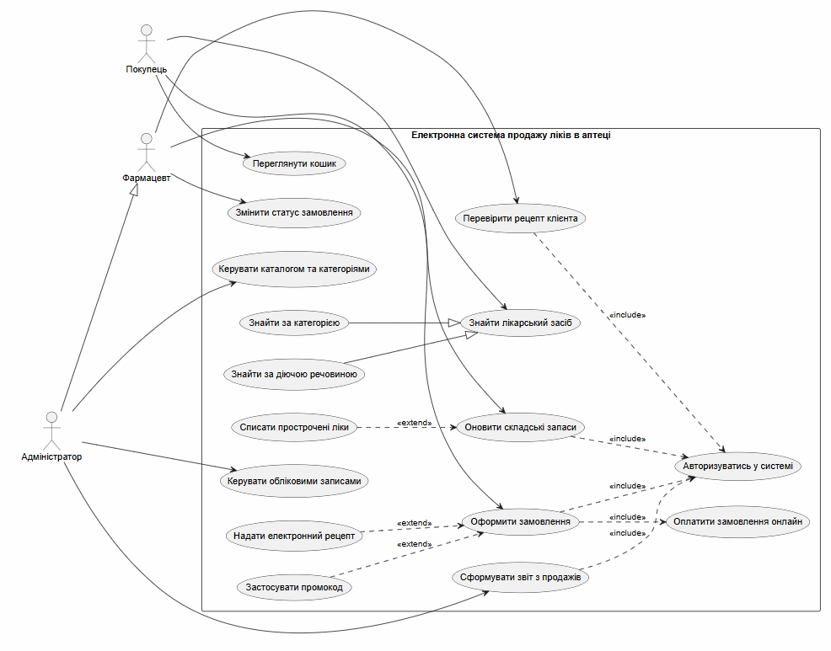
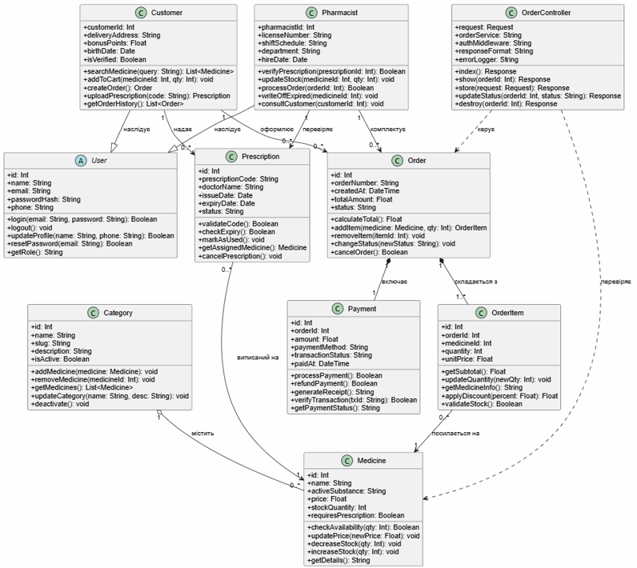

# Проєктування веб-системи: «Електронна система продажу ліків в аптеці»

**Виконала:** студентка групи КН-41 Дудишин Олександра Володимирівна

## 1. Опис предметної галузі та характеристики системи

**Призначення системи:** автоматизація процесів пошуку, замовлення, перевірки електронних рецептів, онлайн-оплати та обліку лікарських засобів в аптеці.

### Основні функції системи:
1. Реєстрація, автентифікація та розмежування прав доступу за ролями (Покупець, Фармацевт, Адміністратор).
2. Перегляд каталогу медикаментів, пошук за назвою, діючою речовиною та фільтрація за категоріями.
3. Перевірка та валідація електронних рецептів (e-Prescription) для рецептурних препаратів.
4. Формування кошика покупок, оформлення замовлення та безготівкова онлайн-оплата.
5. Управління складськими запасами аптеки, контроль термінів придатності та списання прострочених партій.
6. Формування фінансової та складської аналітичної звітності.

### Архітектура та сутності БД (Laravel MVC):
* **Архітектурний патерн:** MVC (Model-View-Controller).
* **Основні таблиці БД:** `users`, `medicines`, `categories`, `prescriptions`, `orders`, `order_items`, `payments`, `suppliers`.

---

## 2. Повний опис Use Case: «Оформити та оплатити замовлення на ліки»

* **Use Case Name:** Оформити та оплатити замовлення на ліки
* **Scope:** Веб-система «Електронна система продажу ліків в аптеці» (System)
* **Level:** User-goal
* **Primary Actor:** Покупець (Клієнт)
* **Preconditions:** Покупець авторизований у системі; у кошику додано щонайменше один препарат.
* **Success Guarantee:** Замовлення збережено зі статусом «Оплачено», препарати зарезервовано на складі, електронний рецепт погашено, сформовано електронний чек.

### Головний успішний сценарій (Main Success Scenario):
1. Покупець переходить до кошика покупок та натискає кнопку «Оформити замовлення».
2. Система перевіряє фактичну наявність обраних препаратів та їхню кількість на складі аптеки.
3. Система аналізує склад кошика та визначає, чи містить він рецептурні препарати.
4. Якщо у кошику є рецептурний препарат, система запитує номер електронного рецепта та код підтвердження.
5. Покупець вводить реквізити електронного рецепта; система верифікує його дійсність та дозування.
6. Покупець обирає спосіб отримання замовлення (самовивіз з аптеки або доставка) та вказує контактні дані.
7. Система розраховує підсумкову вартість замовлення з урахуванням знижок та бонусів.
8. Покупець обирає безготівковий спосіб оплати та переходить на сторінку платіжного шлюзу.
9. Покупець вводить реквізити банківської картки і підтверджує оплату.
10. Платіжна система обробляє транзакцію та повертає статус успішної оплати.
11. Система фіксує замовлення і платіж у БД, зменшує залишок препаратів на складі та змінює статус на «Готується до видачі».
12. Система генерує електронний фіскальний чек і надсилає його на email Покупця.

### Альтернативні сценарії (Extensions):
* **2а) Недостатньо товару на складі:** система повідомляє про доступний залишок і пропонує змінити кількість або обрати аналог.
* **4-5а) Електронний рецепт недійсний або прострочений:** система виводить помилку валідації і пропонує видалити рецептурний препарат із замовлення.
* **7а) Застосування промокоду:** покупець вводить промокод, система перевіряє його дійсність та перераховує суму.
* **9а) Відмова банку при оплаті:** система зберігає замовлення у статусі «Очікує оплати» на 30 хвилин і пропонує повторити оплату.
* **11а) Збій з'єднання з БД:** система виконує відкат транзакції (rollback) та ініціює повернення коштів.

---

## 3. UML-діаграми системи

### Діаграма варіантів використання (Use Case Diagram)

### Діаграма класів (Class Diagram)

